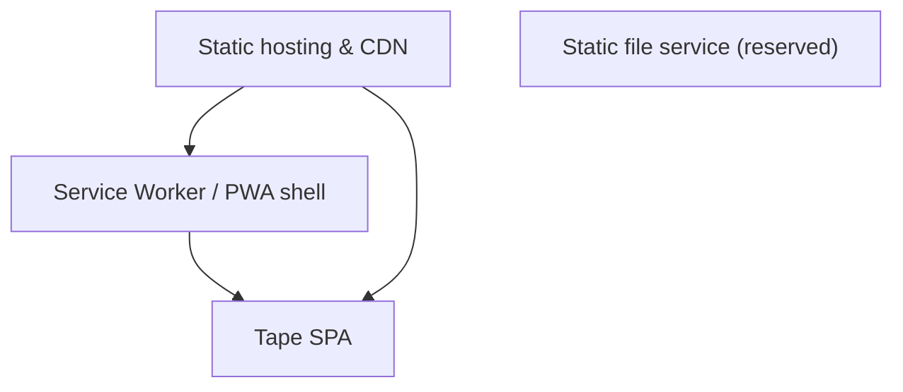
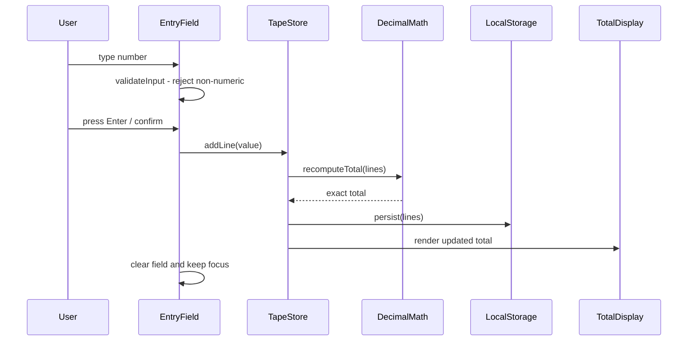
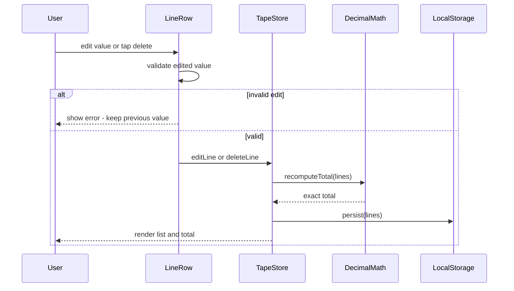
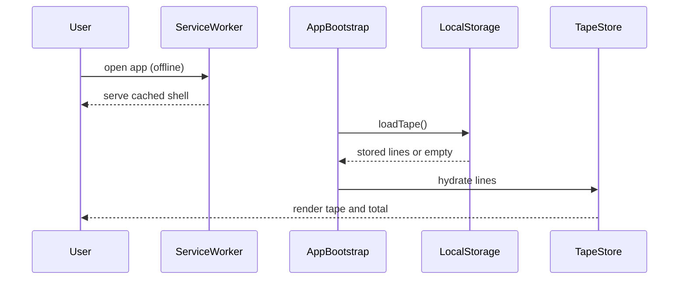
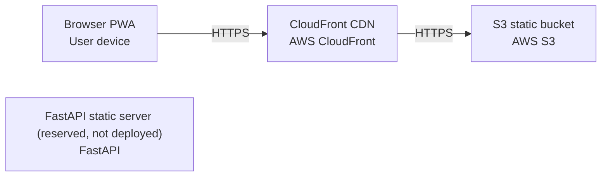

# Architecture

> Maintained by QuorQ AI SDLC. Text between `sdlc:auto` markers is regenerated; anything outside them is yours and is kept.

<!-- sdlc:auto:start narrative -->
## Overview

### ARCH-OVERVIEW · approved · source: architecture:summary

Simple addition is architected as a fully client-side PWA adding-machine tape built in React/TypeScript, with no server-side data handling at launch.

Approved architecture, version 2. The app lets a user key an unbounded list of numbers, each shown as a line, with a running total that updates instantly using exact decimal arithmetic for penny accuracy. The current tape persists in browser local storage to survive accidental refresh. A service worker provides offline support and home-screen installability. No data is stored on a server and no personal data is collected. Delivery is static files from AWS S3 behind CloudFront pinned to an EU region. FastAPI is named as backend of record but, if deployed at all, only as a minimal static file server; PostgreSQL is reserved for a future out-of-scope saved-history feature.

- ⚠ Input does not state who approved this architecture or on what date.
- ⚠ No explicit linkage given between this architecture and specific requirement IDs (US-001..US-020); traceability_matrix for this phase cannot be populated from architecture input alone.

### ARCH-COMP-SPA · approved · source: architecture:components:spa

Tape SPA is the core React component rendering entry field, scrolling line list, and running total.

Component: Tape SPA (React). Renders the entry field, the scrolling list of lines, and the always-visible running total. Validates numeric input at the point of typing. Performs exact decimal addition. Handles add, edit, delete, clear, and copy-to-clipboard actions. Persists the current tape to local storage. Responsive layout: numeric keypad on mobile, full keyboard entry on desktop.

- ⚠ No requirement IDs explicitly cited for this component in the input.

### ARCH-COMP-PWA_SW · approved · source: architecture:components:pwa_sw

Service Worker / PWA shell enables offline use and home-screen installation.

Component: Service Worker / PWA shell (React). Caches the static app shell for offline use after first load and provides the installable home-screen manifest. Attempts no server synchronisation.

- ⚠ No requirement IDs explicitly cited for this component in the input.

### ARCH-COMP-STATIC_HOST · approved · source: architecture:components:static_host

Static hosting and CDN layer serves the built app bundle over HTTPS from an EU region.

Component: Static hosting & CDN (AWS). Serves the built static bundle (HTML, JS, CSS, manifest, service worker) over HTTPS from an EU region. Performs no application data handling.

### ARCH-COMP-API · draft · source: architecture:components:api

Reserved minimal FastAPI static file service, not required or deployed at launch.

Component: Static file service (reserved) (FastAPI). Optional minimal service that could serve the static bundle, and the natural home for saved-tape APIs if that feature is ever added. Not required at launch; deployment status is explicitly reserved/future.

- ⚠ Not deployed at launch -- confirm with deployment phase whether/when this is ever activated.

### ARCH-CP-ADD-LINE · approved · source: architecture:critical_paths:add_line

Critical path for adding a tape line and updating the running total.

User types a number; input is validated as it is typed; on confirm (Enter on desktop / keypad confirm on mobile) a new line is appended; the total is recomputed with exact decimal arithmetic; the new state is persisted to local storage.

- ⚠ No requirement IDs explicitly cited for this critical path in the input.

### ARCH-CP-EDIT-DELETE · approved · source: architecture:critical_paths:edit_delete

Critical path for editing or deleting a line and recalculating the total.

User edits a line's value (validated, cancellable) or deletes a line; the list keeps its order; the total is recomputed exactly; the new state is persisted immediately.

**Related:** ARCH-CP-ADD-LINE

- ⚠ No requirement IDs explicitly cited for this critical path in the input.

### ARCH-CP-OFFLINE-RESTORE · approved · source: architecture:critical_paths:offline_restore

Critical path for offline load and tape restoration on reopen.

On reopen, the service worker serves the cached shell; the app reads the current tape from local storage and rebuilds the lines and total; this works with no network connectivity.

**Related:** ARCH-COMP-PWA_SW

- ⚠ No requirement IDs explicitly cited for this critical path in the input.

### ARCH-ENT-TAPE-LINE · approved · source: architecture:entities:tape_line

Data entity representing a single line on the tape.

Entity: tape_line with fields id, value, position.

### ARCH-ENT-TAPE · approved · source: architecture:entities:tape

Data entity representing the overall tape (collection of lines).

Entity: tape with fields id, updated_at.

**Related:** ARCH-ENT-TAPE-LINE

- ⚠ Input does not state how tape relates structurally to tape_line (e.g. one-to-many) beyond both being listed as entities.

### ARCH-DEPLOY-NODES · approved · source: architecture:deployment_nodes

Deployment topology: S3 + CloudFront serving the browser PWA; FastAPI node reserved and not deployed.

Deployment nodes: (1) S3 static bucket -- AWS S3, static object storage in an EU region. (2) CloudFront CDN -- AWS CloudFront, CDN edge over HTTPS with EU-pinned origin. (3) Browser PWA -- user device, modern browser with service worker and local storage support. (4) FastAPI static server -- reserved, not deployed; Python ASGI (uvicorn) when/if activated.

**Related:** ARCH-COMP-STATIC_HOST, ARCH-COMP-API

- ⚠ FastAPI node is explicitly reserved/not deployed -- confirm actual deployment status once a deployment phase exists.

### ARCH-TECH-FRONTEND · approved · source: architecture:technology_decisions:frontend

React (TypeScript) chosen as frontend framework over Svelte and Vue.

Decision: React. Alternatives considered: Svelte, Vue. Rationale: the whole product lives in the browser and the tape is a live list -- lines appearing, being edited or deleted, the running total updating instantly -- which React handles well. TypeScript is used so exact-decimal number handling is type-checked before shipping. A single codebase delivers phone keypad entry, desktop Enter-to-add, offline-after-first-load, and install-to-home-screen behaviour.

**Related:** ARCH-COMP-SPA

### ARCH-TECH-BACKEND · approved · source: architecture:technology_decisions:backend

FastAPI named as backend of record but not required at launch; alternative considered was no backend at all.

Decision: FastAPI. Alternative considered: no backend at all. Rationale: the product genuinely needs no server at launch -- every sum happens in the browser and the tape lives in local storage. FastAPI is named as backend of record and, if deployed at all, would only be a minimal service serving the static files. It is kept in reserve for a future saved-history or sharing feature, both deliberately excluded from current scope.

**Related:** ARCH-COMP-API

### ARCH-TECH-DATABASE · approved · source: architecture:technology_decisions:database

PostgreSQL reserved for a future saved-history feature; no database runs at launch.

Decision: PostgreSQL. Alternative considered: no database. Rationale: nothing is kept on a server at launch -- the current tape sits in browser local storage with no accounts, cross-device sync, or history. PostgreSQL is named for later use because it stores exact decimal money values natively without rounding drift, which matters given penny accuracy is a hard requirement.

**Related:** ARCH-ENT-TAPE, ARCH-ENT-TAPE-LINE

- ⚠ Saved-history feature using PostgreSQL is explicitly out of scope now -- no current requirement drives this decision.

### ARCH-TECH-CLOUD · approved · source: architecture:technology_decisions:cloud

AWS (S3 + CloudFront) chosen over Cloudflare Pages and Netlify for hosting.

Decision: AWS. Alternatives considered: Cloudflare Pages, Netlify. Rationale: the app is a bundle of static files plus offline caching -- the simplest thing any host can do -- covered by S3 and CloudFront, with hosting pinned to an EU region to keep the privacy story clean. At well under a thousand users the cost is pennies a month, and growing a backend or database later would require no provider move.

**Related:** ARCH-COMP-STATIC_HOST, ARCH-DEPLOY-NODES
<!-- sdlc:auto:end narrative -->

<!-- sdlc:auto:start building-blocks -->
## Building Block View

| ID | Name | Technology | Responsibility | Depends on |
|---|---|---|---|---|
| spa | Tape SPA | React | Renders the entry field, the scrolling list of lines and the always-visible running total; validates numeric input at the point of typing; performs exact decimal addition; handles add, edit, delete, clear and copy-to-clipboard; persists the current tape to local storage; responsive layout with numeric keypad on mobile and full keyboard entry on desktop. | — |
| pwa_sw | Service Worker / PWA shell | React | Caches the static app shell for offline use after first load and provides the installable home-screen manifest; attempts no server synchronisation. | spa |
| static_host | Static hosting & CDN | AWS | Serves the built static bundle (HTML, JS, CSS, manifest, service worker) over HTTPS from an EU region; no application data handling. | spa, pwa_sw |
| api | Static file service (reserved) | FastAPI | Optional minimal service that serves the static bundle; deployed only if a server is wanted later and the natural home for saved-tape APIs if that feature is ever added. Not required at launch. | — |

<!-- sdlc:auto:end building-blocks -->

<!-- sdlc:auto:start runtime -->
## Runtime View

### Add a line and update the running total

User types a number, input is validated as it is typed, on confirm (Enter on desktop / keypad confirm on mobile) a new line is appended, the total is recomputed with exact decimal arithmetic, and the new state is persisted to local storage.

- **Components:** spa
- **Modules:** EntryField, TapeList, TotalDisplay, decimalMath, tapeStore, localStoragePersistence
- **Key functions:** validateInput(raw), addLine(value), recomputeTotal(lines), persist(lines)

### Edit or delete a line and recalculate

User edits a line's value (validated, cancellable) or deletes a line; the list keeps order, the total is recomputed exactly and the new state is persisted immediately.

- **Components:** spa
- **Modules:** TapeList, LineRow, decimalMath, tapeStore, localStoragePersistence
- **Key functions:** editLine(id, newValue), deleteLine(id), recomputeTotal(lines), persist(lines)

### Offline load and tape restore

On reopen, the service worker serves the cached shell, the app reads the current tape from local storage and rebuilds the lines and total; works with no network.

- **Components:** spa, pwa_sw
- **Modules:** ServiceWorker, appBootstrap, localStoragePersistence, tapeStore, decimalMath
- **Key functions:** cacheFirst(request), loadTape(), recomputeTotal(lines)

<!-- sdlc:auto:end runtime -->

<!-- sdlc:auto:start deployment-view -->
## Deployment View

| Name | Service | Runtime | Scaling | Environment |
|---|---|---|---|---|
| S3 static bucket | AWS S3 | Static object storage (EU region) | Managed by AWS, effectively unlimited for a static bundle | dev |
| CloudFront CDN | AWS CloudFront | CDN edge over HTTPS, EU-pinned origin | Auto-scaled by AWS | dev |
| Browser PWA | User device | Modern browser with service worker + local storage | Per device | dev |
| FastAPI static server (reserved, not deployed) | FastAPI | Python ASGI (uvicorn) | Single small instance if ever used | dev |

| Source | Target | Protocol |
|---|---|---|
| Browser PWA | CloudFront CDN | HTTPS |
| CloudFront CDN | S3 static bucket | HTTPS |

<!-- sdlc:auto:end deployment-view -->

<!-- sdlc:auto:start decisions -->
## Architecture Decisions

| Layer | Choice | ADR |
|---|---|---|
| Frontend | React | [ADR-0001](adr/frontend.md) |
| Backend | FastAPI | [ADR-0002](adr/backend.md) |
| Database | PostgreSQL | [ADR-0003](adr/database.md) |
| Cloud | AWS | [ADR-0004](adr/cloud.md) |
<!-- sdlc:auto:end decisions -->

<!-- sdlc:auto:start links -->
## Related Documents

- [Data Model](data-model.md)
- [API Specification](api/openapi.yaml)
- [Architecture Decision Records](adr/README.md)
<!-- sdlc:auto:end links -->
