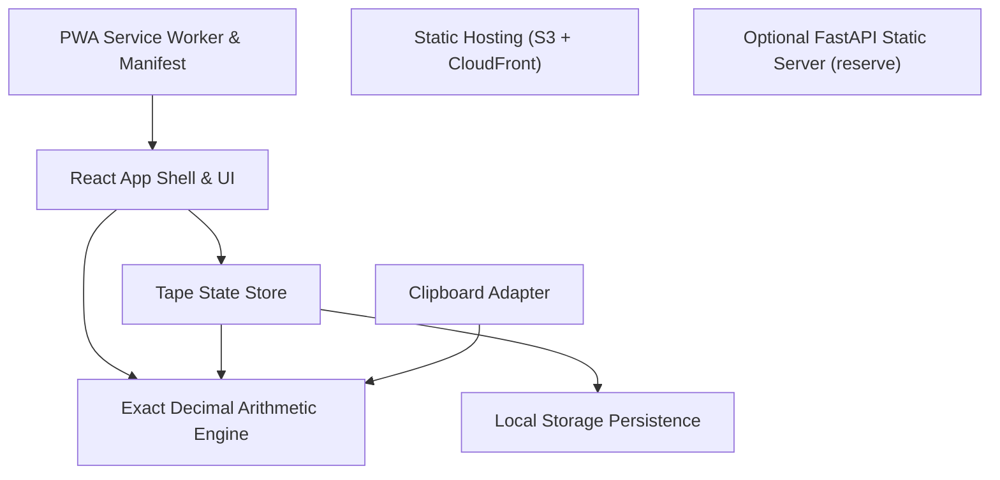
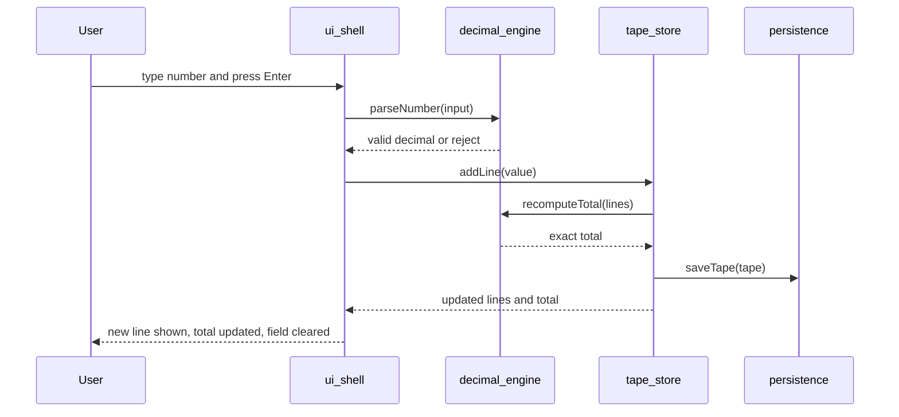
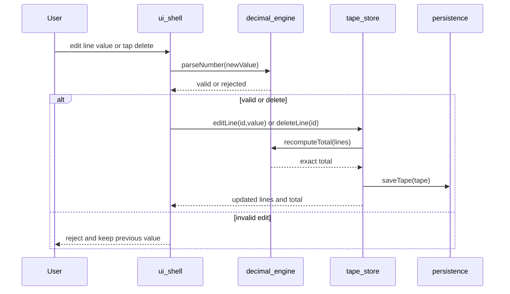
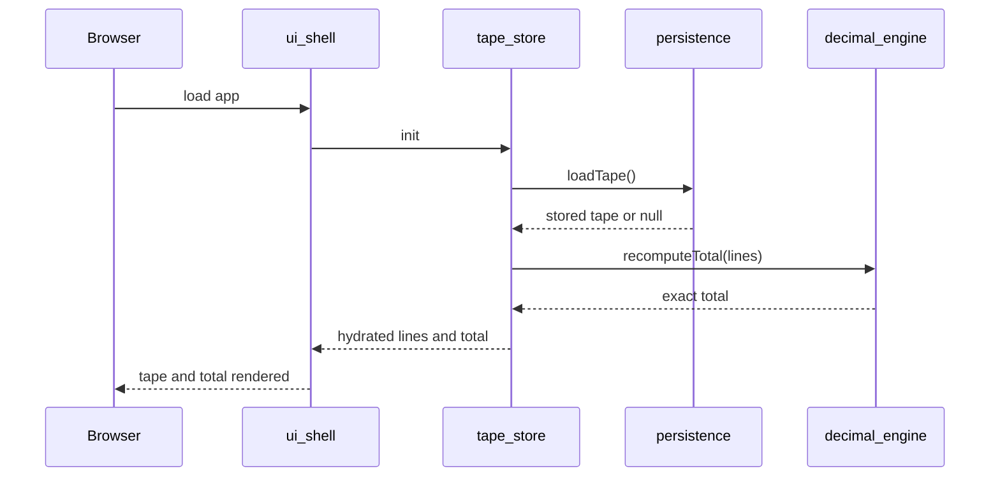
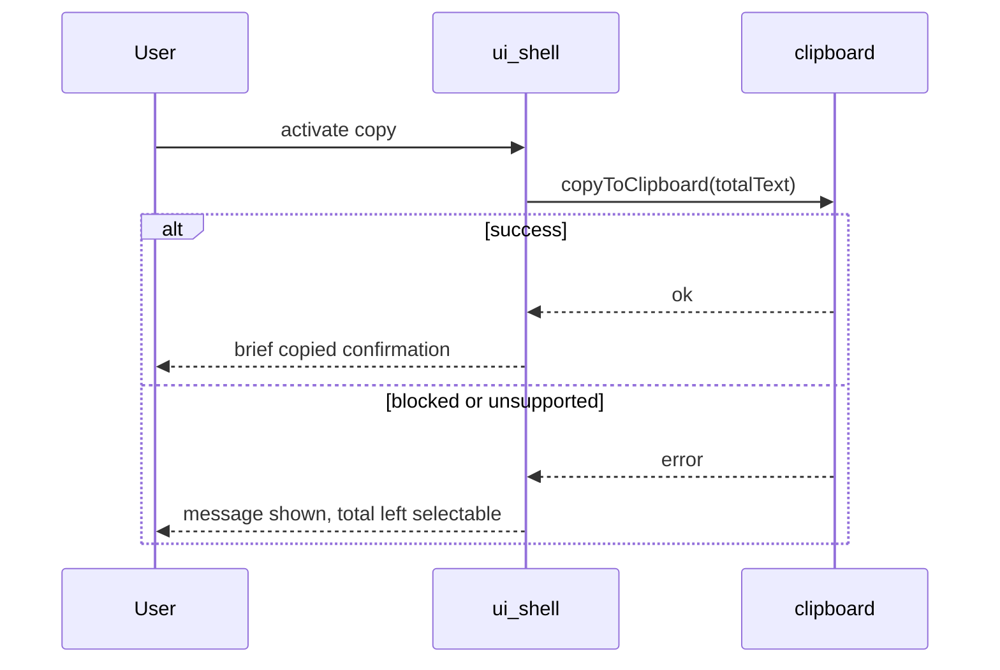
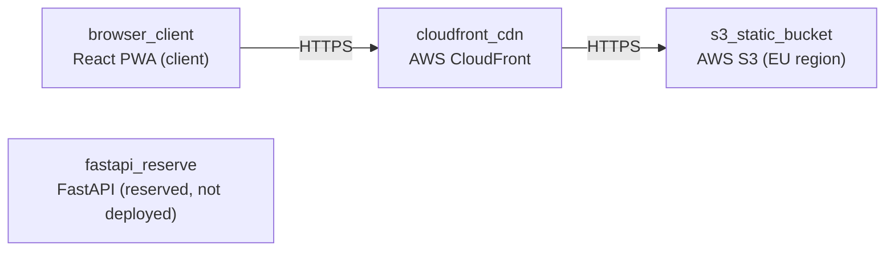

# Architecture

> Maintained by QuorQ AI SDLC. Text between `sdlc:auto` markers is regenerated; anything outside them is yours and is kept.

<!-- sdlc:auto:start narrative -->
## Overview

### ARCH-000-OVERVIEW · approved · source: architecture:summary

Approved v1 architecture: a client-side-only, offline-capable React+TypeScript PWA computing exact-decimal totals, persisting the current tape to browser local storage, served as static files from AWS S3+CloudFront pinned to an EU region. No server-side component is deployed at launch.

Technology decisions (approved):
- Frontend: React + TypeScript (PWA) - fits live-list tape rendering; TypeScript type-checks exact-decimal handling; single codebase delivers responsive phone/desk behaviour, mobile numeric keypad, Enter-to-add, offline use and install-to-home-screen.
- Backend: FastAPI - named choice of record but nothing deployed at launch; every sum happens in-browser so no API is needed now; reserved to serve static files or power future saved-history/sharing.
- Database: PostgreSQL - named for later; no database runs at launch since nothing is kept server-side; native numeric type would store exact decimal money values without rounding drift if saved tapes/accounts are added later.
- Cloud: AWS (S3 + CloudFront, EU region) - simplest host for a static bundle plus offline caching; origin pinned to EU for the privacy story; cost 'pennies a month' at assumed sub-1000-user scale; staying on AWS avoids a provider migration if a backend/database is added later.

**Related:** EPIC-001, EPIC-002, EPIC-003, EPIC-004, EPIC-005, EPIC-006

- ⚠ No documented trigger/milestone for when the reserved FastAPI backend or PostgreSQL database would actually be activated.

### ARCH-UI-SHELL · approved · source: architecture:ui_shell

React App Shell & UI component (React + TypeScript, Vite, CSS) renders the responsive tape UI and handles keyboard and mobile keypad interaction.

Renders entry field, scrolling line list, sticky running total, per-line edit/delete plus clear/copy controls. Handles keyboard (Enter-to-add, Tab navigation) and mobile numeric keypad behaviour.

**Related:** US-001, US-002, US-003, US-004, US-005, US-006, US-007, US-013, US-014, US-015, US-018

### ARCH-TAPE-STORE · approved · source: architecture:tape_store

Tape State Store (TypeScript state module, React context/reducer) holds the single current tape in memory and applies add/edit/delete/clear operations.

Coordinates persistence and total recalculation for the single-tape data model; drives the single-tape-per-device requirement.

**Related:** US-001, US-002, US-003, US-005, US-006, US-007, US-017

### ARCH-DECIMAL-ENGINE · approved · source: architecture:decimal_engine

Exact Decimal Arithmetic Engine (TypeScript wrapper over decimal.js / big.js) parses and validates numeric input and sums values with exact decimal precision.

Rejects non-numeric characters at input and guarantees penny-accurate totals with no floating-point drift, directly implementing EPIC-003 requirements.

**Related:** US-009, US-010, US-011, US-012

### ARCH-PERSISTENCE · approved · source: architecture:persistence

Local Storage Persistence (Web Storage API) serialises the current tape to browser local storage on every change and restores it on load.

Degrades gracefully to in-memory-only when storage is blocked, matching AC-049's requirement that the app remain usable if storage is unavailable.

**Related:** US-016, US-007

### ARCH-PWA-SW · approved · source: architecture:pwa_sw

PWA Service Worker & Manifest (Service Worker + Web App Manifest via Workbox/Vite PWA) caches the app shell for offline use and enables install-to-home-screen.

Implements the offline-after-first-load and installable-with-name-and-icon requirements from EPIC-006.

**Related:** US-020

### ARCH-CLIPBOARD · approved · source: architecture:clipboard

Clipboard Adapter (Clipboard API, TypeScript adapter) copies the exact total to the clipboard as plain text with confirmation.

Falls back to selectable text when clipboard access is unavailable, matching AC-022.

**Related:** US-008

### ARCH-STATIC-HOSTING · approved · source: architecture:static_hosting

Static Hosting (AWS S3 + CloudFront) serves the static React/PWA bundle globally over HTTPS with origin pinned to an EU region.

Implements the 'client-side-only static site, no backend/database, hosted in EU' requirement (AC-057).

**Related:** US-018, US-019

### ARCH-FASTAPI-OPTIONAL · approved · source: architecture:fastapi_optional

Optional FastAPI Static Server is named backend of record but deploys nothing at launch.

Reserved for potentially serving static files, or later backing saved-history/sharing features that are explicitly out of scope for v1.

**Related:** US-019
<!-- sdlc:auto:end narrative -->

<!-- sdlc:auto:start building-blocks -->
## Building Block View

| ID | Name | Technology | Responsibility | Depends on |
|---|---|---|---|---|
| ui_shell | React App Shell & UI | React + TypeScript, Vite, CSS | Renders the responsive tape UI: entry field, scrolling list of lines, sticky running total, and per-line edit/delete plus clear/copy controls. Handles keyboard (Enter-to-add, Tab navigation) and mobile numeric keypad behaviour. | tape_store, decimal_engine |
| tape_store | Tape State Store | TypeScript state module (React context/reducer) | Holds the single current tape (ordered lines) in memory, applies add/edit/delete/clear operations, and coordinates persistence and total recalculation. | decimal_engine, persistence |
| decimal_engine | Exact Decimal Arithmetic Engine | TypeScript wrapper over decimal.js / big.js | Parses and validates numeric input, rejects non-numeric characters, and sums line values with exact decimal precision so totals are penny-accurate. | — |
| persistence | Local Storage Persistence | Web Storage API (localStorage) | Serialises the current tape to browser local storage on every change and restores it on load; degrades gracefully to in-memory-only when storage is blocked. | — |
| pwa_sw | PWA Service Worker & Manifest | Service Worker + Web App Manifest (Workbox via Vite PWA) | Caches the app shell for offline use after first load and enables install-to-home-screen with name and icon. | ui_shell |
| clipboard | Clipboard Adapter | Clipboard API (TypeScript adapter) | Copies the exact total to the clipboard as plain text with confirmation, and falls back to selectable text when clipboard access is unavailable. | decimal_engine |
| static_hosting | Static Hosting (S3 + CloudFront) | AWS S3 + CloudFront | Serves the static React/PWA bundle globally over HTTPS with origin pinned to an EU region for the privacy story. | — |
| fastapi_optional | Optional FastAPI Static Server (reserve) | FastAPI (Python) — reserved, not deployed at launch | Named backend of record, deployed nothing at launch; a minimal FastAPI app could serve the static files or, later, back saved-history/sharing features. | — |

<!-- sdlc:auto:end building-blocks -->

<!-- sdlc:auto:start runtime -->
## Runtime View

### Add a line and update total

User types a valid number and confirms (Enter on desktop, on-screen confirm on mobile). The value is validated, appended as a new line, the total recalculated with exact decimal arithmetic, persisted, and the field cleared and refocused.

- **Components:** ui_shell, tape_store, decimal_engine, persistence
- **Modules:** EntryField, tapeReducer, decimal, storage
- **Key functions:** parseNumber(input): DecimalResult, addLine(value), recomputeTotal(lines): Decimal, saveTape(tape)

### Edit or delete a line and recalculate

User edits a line to a new valid value or deletes it. Invalid edits are rejected with a visible indication and the old value kept; valid changes update in place, recompute the total exactly, and persist immediately.

- **Components:** ui_shell, tape_store, decimal_engine, persistence
- **Modules:** TapeLine, tapeReducer, decimal, storage
- **Key functions:** editLine(id, value), deleteLine(id), parseNumber(input), recomputeTotal(lines), saveTape(tape)

### Restore tape after refresh

On load the store reads the persisted tape from local storage and rehydrates lines and total, so an accidental refresh restores the latest state; if storage is unavailable the app starts empty and works for the session.

- **Components:** ui_shell, tape_store, persistence, decimal_engine
- **Modules:** App, tapeReducer, storage, decimal
- **Key functions:** loadTape(): Tape \| null, recomputeTotal(lines), hydrate(tape)

### Copy total to clipboard

User activates copy, the exact plain-text total is written to the clipboard with a brief confirmation, or a clear message plus selectable total is shown when clipboard access is blocked.

- **Components:** ui_shell, clipboard, decimal_engine
- **Modules:** TotalBar, clipboardAdapter, decimal
- **Key functions:** formatTotal(total): string, copyToClipboard(text): Promise, showConfirmation()

<!-- sdlc:auto:end runtime -->

<!-- sdlc:auto:start deployment-view -->
## Deployment View

| Name | Service | Runtime | Scaling | Environment |
|---|---|---|---|---|
| s3_static_bucket | AWS S3 (EU region) | Static object storage | Managed, effectively unlimited for a static bundle | dev |
| cloudfront_cdn | AWS CloudFront | Global CDN edge with HTTPS | Auto-scaled edge caching | dev |
| browser_client | React PWA (client) | User browser + service worker cache | Per-device; offline after first load | dev |
| fastapi_reserve | FastAPI (reserved, not deployed) | Python/Uvicorn — provisioned only if backend features are added later | N/A at launch | dev |

| Source | Target | Protocol |
|---|---|---|
| browser_client | cloudfront_cdn | HTTPS |
| cloudfront_cdn | s3_static_bucket | HTTPS |

<!-- sdlc:auto:end deployment-view -->

<!-- sdlc:auto:start decisions -->
## Architecture Decisions

| Layer | Choice | ADR |
|---|---|---|
| Frontend | React + TypeScript (PWA) | [ADR-0001](adr/frontend.md) |
| Backend | FastAPI (reserved, nothing deployed at launch) | [ADR-0002](adr/backend.md) |
| Database | PostgreSQL (reserved, no database at launch) | [ADR-0003](adr/database.md) |
| Cloud | AWS (S3 + CloudFront, EU region) | [ADR-0004](adr/cloud.md) |
<!-- sdlc:auto:end decisions -->

<!-- sdlc:auto:start links -->
## Related Documents

- [Data Model](data-model.md)
- [API Specification](api/openapi.yaml)
- [Architecture Decision Records](adr/README.md)
<!-- sdlc:auto:end links -->
