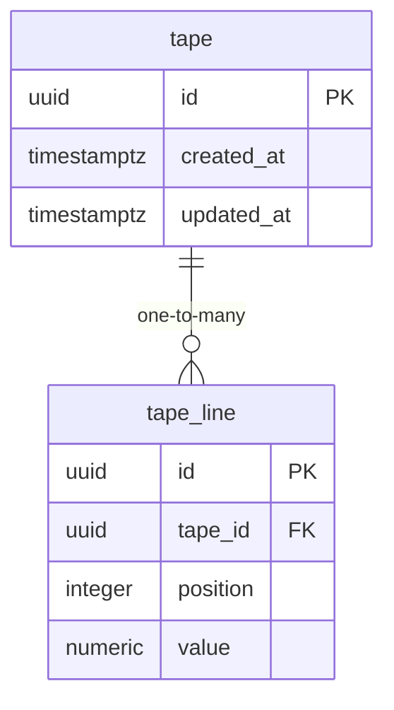

# Data Model

<!-- sdlc:auto:start entities -->
### tape

| Field | Type | PK | FK | Nullable |
|---|---|---|---|---|
| id | uuid | True | — | False |
| created_at | timestamptz | False | — | False |
| updated_at | timestamptz | False | — | False |

### tape_line

| Field | Type | PK | FK | Nullable |
|---|---|---|---|---|
| id | uuid | True | — | False |
| tape_id | uuid | False | tape.id | False |
| position | integer | False | — | False |
| value | numeric | False | — | False |
<!-- sdlc:auto:end entities -->

<!-- sdlc:auto:start relationships -->
| Source | Target | Type |
|---|---|---|
| tape | tape_line | one-to-many |
<!-- sdlc:auto:end relationships -->

<!-- sdlc:auto:start er-diagram -->

<!-- sdlc:auto:end er-diagram -->
