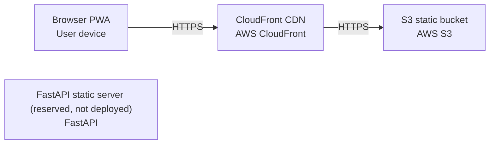

# Deployment Guide

> Maintained by QuorQ AI SDLC. Text between `sdlc:auto` markers is regenerated; anything outside them is yours and is kept.

<!-- sdlc:auto:start how-it-deploys -->
Pushes to `main` run `.github/workflows/deploy.yml`, which builds the API image (if there is a backend) and deploys the SPA to AWS Amplify. Commits touching only `docs/sdlc/**` don't deploy. Deployments can also be started from the platform's Deployment tab.
<!-- sdlc:auto:end how-it-deploys -->

<!-- sdlc:auto:start environments -->
| Name | Service | Runtime | Scaling | Environment |
|---|---|---|---|---|
| S3 static bucket | AWS S3 | Static object storage (EU region) | Managed by AWS, effectively unlimited for a static bundle | dev |
| CloudFront CDN | AWS CloudFront | CDN edge over HTTPS, EU-pinned origin | Auto-scaled by AWS | dev |
| Browser PWA | User device | Modern browser with service worker + local storage | Per device | dev |
| FastAPI static server (reserved, not deployed) | FastAPI | Python ASGI (uvicorn) | Single small instance if ever used | dev |
<!-- sdlc:auto:end environments -->

<!-- sdlc:auto:start live -->
_Not deployed yet._
<!-- sdlc:auto:end live -->

<!-- sdlc:auto:start topology -->

<!-- sdlc:auto:end topology -->
