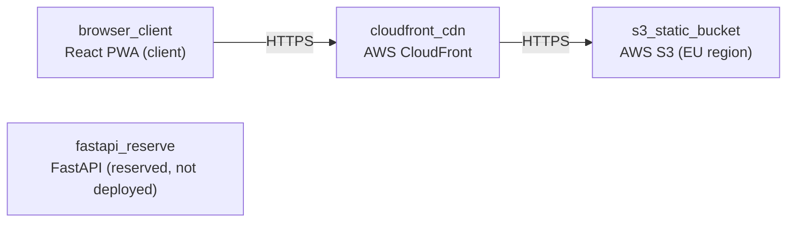

# Deployment Guide

> Maintained by QuorQ AI SDLC. Text between `sdlc:auto` markers is regenerated; anything outside them is yours and is kept.

<!-- sdlc:auto:start how-it-deploys -->
Pushes to `main` run `.github/workflows/deploy.yml`, which builds the API image (if there is a backend) and deploys the SPA to AWS Amplify. Commits touching only `docs/sdlc/**` don't deploy. Deployments can also be started from the platform's Deployment tab.
<!-- sdlc:auto:end how-it-deploys -->

<!-- sdlc:auto:start environments -->
| Name | Service | Runtime | Scaling | Environment |
|---|---|---|---|---|
| s3_static_bucket | AWS S3 (EU region) | Static object storage | Managed, effectively unlimited for a static bundle | dev |
| cloudfront_cdn | AWS CloudFront | Global CDN edge with HTTPS | Auto-scaled edge caching | dev |
| browser_client | React PWA (client) | User browser + service worker cache | Per-device; offline after first load | dev |
| fastapi_reserve | FastAPI (reserved, not deployed) | Python/Uvicorn — provisioned only if backend features are added later | N/A at launch | dev |
<!-- sdlc:auto:end environments -->

<!-- sdlc:auto:start live -->
_Not deployed yet._
<!-- sdlc:auto:end live -->

<!-- sdlc:auto:start topology -->

<!-- sdlc:auto:end topology -->
